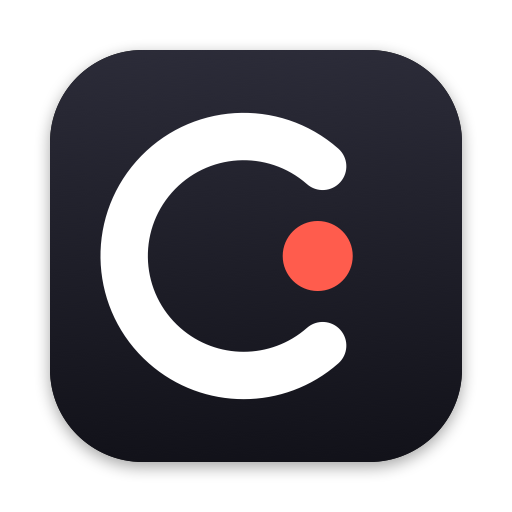

<p align="center">
  
</p>

<h1 align="center">Catchy</h1>

<p align="center">Copy it, and it's already in your calendar.<br>
A macOS menu bar app that turns dates you copy or capture into calendar events and reminders, using Apple's on-device AI.</p>

---

You see dates everywhere: on flyers, in group chats, in emails, on webinar pages. Getting them into a calendar means retyping them. Catchy watches for the moment you copy one, reads it with Apple's on-device language model, and shows a ready-made event in a black island that grows out of the notch. One click saves it, and iCloud puts it on your iPhone and Apple Watch.

Nothing leaves your Mac. There's no account, no server and no cloud AI.

## What it does

| Catch it… | …and Catchy |
|---|---|
| **Copy text** with a date, on your Mac or your iPhone (Universal Clipboard) | opens a pre-filled event card |
| **Copy a picture**: a screenshot, or a photo of a poster copied on your iPhone | reads the text in it and opens the card |
| **Tap ⌥⌘** (Option + Command together) and drag over part of the screen | reads that area and opens the card |
| Select text, right-click › **Services › Catch with Catchy** | opens the card |
| **Tap ⌃⌘** (Control + Command) and just say it, however casually | turns what you said into a card; with a card open, it changes that card |
| **Hover the notch** | opens a quick panel: Capture, Clipboard and Voice, or the card you left waiting |

- **Understands messy text:** relative dates ("this saturday 7-10pm"), split dates and times ("Sat, Oct 24 • 4pm"), and titles written in all caps.
- **Time zones:** "Thursday 3:00 pm ET" lands at the right local time, and the card notes the original time.
- **Schedules:** several dates in one catch (a syllabus or an agenda) show as a checklist. **Add 3 Events** adds them all.
- **Tasks:** "Submit the report by Friday" becomes a reminder in Reminders, not an event.
- **Clash warning:** the card flags anything already in your calendar at that time.
- **Undo** right after saving.
- **Pause Catching** and **Launch at Login** in the ••• menu.
- **Lives in the notch:** a pitch-black island grows out of the notch like the Dynamic Island. Nothing stays on screen while idle, and it works over full-screen apps.

## Requirements

- A Mac with Apple Silicon, running **macOS 26 (Tahoe)** or later.
- **Apple Intelligence turned on** (System Settings › Apple Intelligence & Siri) for the AI extraction. Without it, Catchy falls back to Apple's built-in date detector and says so on the card.
- **Xcode 26** to build.

## Build and run

```sh
git clone <this repo> && cd Catchy
open Catchy.xcodeproj        # then Product › Run
```

Or from the terminal:

```sh
xcodebuild -project Catchy.xcodeproj -scheme Catchy -configuration Debug -derivedDataPath build build
open build/Build/Products/Debug/Catchy.app
```

To build on your own machine, set your team in *Signing & Capabilities* (or change `DEVELOPMENT_TEAM` in `project.yml` and run `xcodegen generate`). Catchy uses the Time Sensitive Notifications entitlement, so Xcode creates a provisioning profile for your team. If your account can't, delete `com.apple.developer.usernotifications.time-sensitive` from `project.yml` and run `xcodegen generate`; everything else works without it. The project file is generated by [XcodeGen](https://github.com/yonaskolb/XcodeGen) from `project.yml`.

### Run the tests

```sh
xcodebuild test -project Catchy.xcodeproj -scheme Catchy -derivedDataPath build
```

The tests (Swift Testing, in `CatchyTests/`) cover date, time and time-zone parsing, with expectations in UTC so they pass in any zone.

### Try it in 10 seconds

```sh
printf 'SPRING FLING!!\npotluck + live music\nthis saturday 7-10pm\nRiverside Park' | pbcopy
```

A card for Saturday, 19:00–22:00 grows out of the notch.

## Permissions

Catchy only asks for a permission when you first need it:

| Permission | When | Why |
|---|---|---|
| Calendars | First **Add to Calendar** | Save events; pick an iCloud calendar so they reach your iPhone |
| Reminders | First **Add to Reminders** | Save tasks |
| Screen Recording | First screen capture | Read the area you select. macOS applies this only after a relaunch, so Catchy shows a **Reopen Catchy** button |
| Input Monitoring | **Turn On** in the island | Notice the ⌥⌘ and ⌃⌘ taps (shortcuts with no letter key need it). Catchy never records what you type |
| Microphone | First voice catch | Hear you, only while the island says "Listening…". Transcribed on the Mac |

If one is denied, the card says so and links to the right pane in System Settings.

## Privacy

- Catchy asks macOS (`NSPasteboard.detectedPatterns`) whether the clipboard contains an event. Longer text is only read when macOS says it does. Short, chat-length text is also checked on-device for times like "in 20 mins", which macOS misses. Nothing is stored or sent anywhere.
- Copies that password managers mark as secret are ignored.
- Text recognition (Vision) and understanding (Foundation Models) run on-device. The app makes no network requests.

## How it works

```
copy / ⌥⌘ / Services ─▶ Vision (if it's an image) ─▶ NSDataDetector anchors ─▶ Foundation Models
                                                                                  (@Generable GeneratedCatch)
                                         Calendar / Reminders ◀── EventKit ◀── editable card in the notch island
                                                  │
                                                  └─ iCloud ─▶ iPhone, Apple Watch
```

- `Catchy/Services/EventExtractor.swift`: guided generation into a typed `GeneratedCatch` (events and tasks, times as written, plus their time zone).
- `Catchy/Services/DateHints.swift`: Apple's date detector gives already-resolved dates to the model, and is the fallback when the model is unavailable.
- `Catchy/Services/ClipboardWatcher.swift`, `ModifierTapHotKey.swift`, `ServiceProvider.swift`: the three ways in.
- `Catchy/Services/CalendarService.swift`: EventKit saving, clashes and undo.
- `Catchy/UI/Island.swift`: the pitch-black island that grows out of the notch, like the Dynamic Island.
- `Catchy/App/StatusItemController.swift`: the menu bar icon that opens it.

## Built with the Devpost Learn Skill Pack

Catchy was planned and built for [Build With AI: Basics](https://learn-ai-basics.devpost.com/) using the [Devpost Learn Skill Pack](https://github.com/challengepost/learn-ai-basics) in Claude Code. The planning documents are in [`devpost/`](devpost/):

- [`scope.md`](devpost/scope.md)
- [`prd.md`](devpost/prd.md)
- [`spec.md`](devpost/spec.md)
- [`checklist.md`](devpost/checklist.md)

## License

[MIT](LICENSE)
